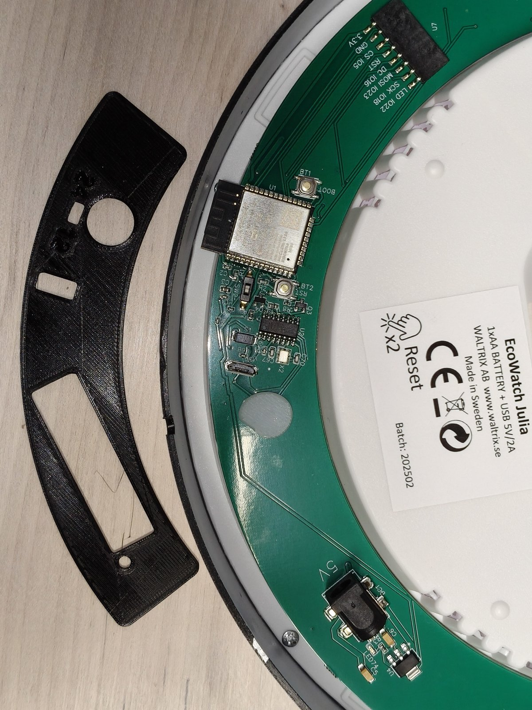

# EcoWatch Julia → ESPHome

Reverse engineering and custom [ESPHome](https://esphome.io) firmware for the
**EcoWatch Julia** electricity-price clock by Waltrix AB (PCB "Waltrix 3.0.1",
ESP32-WROOM-32, CH340 USB-serial, RGB LED rings; the analog hands run on their own AA battery).



## Layout

| Path | What |
|------|------|
| [docs/hardware.md](docs/hardware.md) | Known parts, pinout, open questions |
| [docs/reverse-engineering.md](docs/reverse-engineering.md) | Step-by-step workflow |
| [tools/web_recon.py](tools/web_recon.py) | Saves the stock web UI, checks for Tasmota/WiFiManager endpoints |
| [tools/backup_flash.ps1](tools/backup_flash.ps1) | Verified full-flash backup of the stock firmware |
| [tools/analyze_dump.py](tools/analyze_dump.py) | Partition table, app version info, fingerprints, strings (full dump or OTA .bin) |
| [esphome/ledfinder.yaml](esphome/ledfinder.yaml) | Finds the LED-ring data pin(s) |
| [esphome/probe.yaml](esphome/probe.yaml) | GPIO / ADC discovery firmware |
| [esphome/ecowatch-julia.yaml](esphome/ecowatch-julia.yaml) | The actual firmware (work in progress) |

## Quick start

```powershell
pip install esptool esphome
python tools/web_recon.py ecowatch.local      # 1. look at the stock UI while it still runs
./tools/backup_flash.ps1 -Port COM9          # 2. back up stock firmware (never skip)
python tools/analyze_dump.py dumps/<file>.bin # 3. see what's inside
copy esphome/secrets.yaml.example esphome/secrets.yaml
esphome run esphome/ledfinder.yaml            # 4. find the LED data pin
esphome run esphome/ecowatch-julia.yaml       # 5. real firmware
```

Restore stock firmware: `esptool --port COM9 write_flash 0x0 dumps/<file>.bin`
