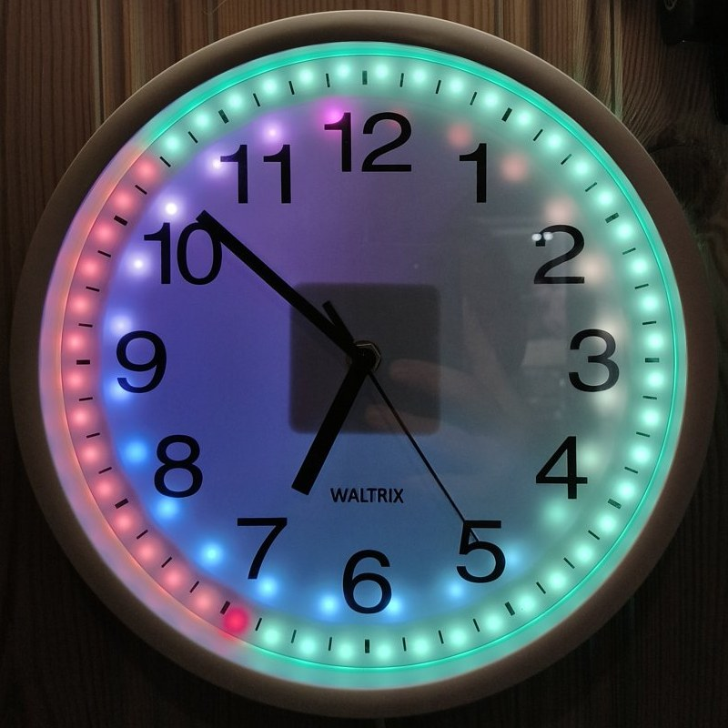

# EcoWatch Julia → ESPHome

Reverse engineering and custom [ESPHome](https://esphome.io) firmware for the
**EcoWatch Julia** electricity-price clock by Waltrix AB (PCB "Waltrix 3.0.1",
ESP32-WROOM-32, CH340 USB-serial, RGB LED rings; the analog hands run on their own AA battery).
The clock is then run entirely from Home Assistant, with no vendor cloud.



What you get (details in [docs/home-assistant.md](docs/home-assistant.md)):

- **Price display like the stock firmware:** green / yellow / red per 15 min or per hour for the
  next 12 hours, using prices your Home Assistant sends (spotprices2ha, Nord Pool or anything else).
  Colour modes: daily average, your own limits, cheapest N hours.
- Each ring can instead show **tariff hours**, **live house power**, **your own per-LED colours**,
  or be a plain light with effects.
- **Blink alerts** on chosen LEDs from any automation.
- Flash the current hour or quarter, an **LED current limiter** for weak USB supplies, all settings
  as Home Assistant entities.

## Install with Home Assistant

You need Home Assistant, a computer with Chrome or Edge, and a micro-USB **data** cable
(charge-only cables don't work). The first install is over USB; after that, updates go over Wi-Fi.

### 1. Create the device in ESPHome

1. In Home Assistant, install the **ESPHome Device Builder** app (Settings → Apps) and open it.
2. **+ New device** → name it `ecowatch-julia` → **ESP32** → skip the install for now.
3. Click **Edit** on the new device. Keep everything the wizard wrote (your generated API key and
   passwords) and paste this at the end:

   ```yaml
   external_components:
     - source: github://whcrg/ecowatch-julia-esphome@main
       components: [ecowatch]

   packages:
     ecowatch:
       url: https://github.com/whcrg/ecowatch-julia-esphome
       ref: main
       files: [esphome/ecowatch-julia-base.yaml]
       refresh: 1d
   ```

4. Check that the `esp32:` block says `board: esp32dev` and `type: esp-idf`. **Save**.

The firmware code and settings are fetched from this repository when you build, so nothing else
has to be copied to Home Assistant. A complete example is in
[esphome/ecowatch-julia-ha.yaml](esphome/ecowatch-julia-ha.yaml).

### 2. Back up the original firmware (recommended)

The original firmware can't be downloaded anywhere, so keep a copy before you overwrite it.
Open the clock's back cover, connect its micro-USB port to your computer, then:

```bash
pip install esptool
esptool --port COM3 read_flash 0 ALL ecowatch-original.bin
```

Use your port instead of `COM3` (Windows: Device Manager → Ports, "USB-SERIAL CH340";
Linux: `/dev/ttyUSB0`; macOS: `/dev/cu.wchusbserial…`). Reading 4 MB takes a few minutes.
To go back to the original firmware later:
`esptool --port COM3 write_flash 0 ecowatch-original.bin`.

### 3. First install (USB, once)

1. In the Device Builder: **Install** → **Manual download** → **Factory format**. The first build
   takes several minutes.
2. With the clock still connected by USB, open [web.esphome.io](https://web.esphome.io) in Chrome or
   Edge → **Connect** → choose the CH340 serial port → **Install** → pick the downloaded file.
3. Close the cover and hang the clock back up. From now on, use **Install** → **Wirelessly**.

### 4. Add it to Home Assistant

Settings → Devices & services shows **EcoWatch Julia** as discovered → **Configure**. If it asks
for the encryption key, copy it from the `api:` section of the device's YAML.

### 5. Send prices

The clock stores prices sent by Home Assistant. Set up one of the price automations in
[docs/home-assistant.md](docs/home-assistant.md) (spotprices2ha or Nord Pool). Until prices arrive,
the outer ring is purple (or dark with *Hide hours without price* on).

## Repository layout

| Path | What |
|------|------|
| [docs/home-assistant.md](docs/home-assistant.md) | Entities, display rules, price automations, custom LEDs, blink alerts |
| [docs/hardware.md](docs/hardware.md) | Parts, pinout, LED layout, stock firmware findings |
| [docs/reverse-engineering.md](docs/reverse-engineering.md) | How the clock was taken apart, step by step |
| [esphome/ecowatch-julia-base.yaml](esphome/ecowatch-julia-base.yaml) | The firmware configuration (used as a package) |
| [components/ecowatch/](components/ecowatch/) | Display logic in C++ (ESPHome external component) |
| [esphome/ecowatch-julia-ha.yaml](esphome/ecowatch-julia-ha.yaml) | Example device config for the Device Builder |
| [esphome/ecowatch-julia.yaml](esphome/ecowatch-julia.yaml) | Development config that builds from the local files |
| [tools/](tools/) | Flash backup, dump analysis, stock web UI probe |
| [esphome/ledfinder.yaml](esphome/ledfinder.yaml), [probe.yaml](esphome/probe.yaml), [ringtest.yaml](esphome/ringtest.yaml) | Hardware discovery firmwares used during reverse engineering |

## Building from this repository (development)

```powershell
pip install esptool esphome
copy esphome/secrets.yaml.example esphome/secrets.yaml   # fill in Wi-Fi, API key, OTA password
esphome run esphome/ecowatch-julia.yaml --device COM3     # first time over USB, later the clock's IP
```

## License

MIT, see [LICENSE](LICENSE).
